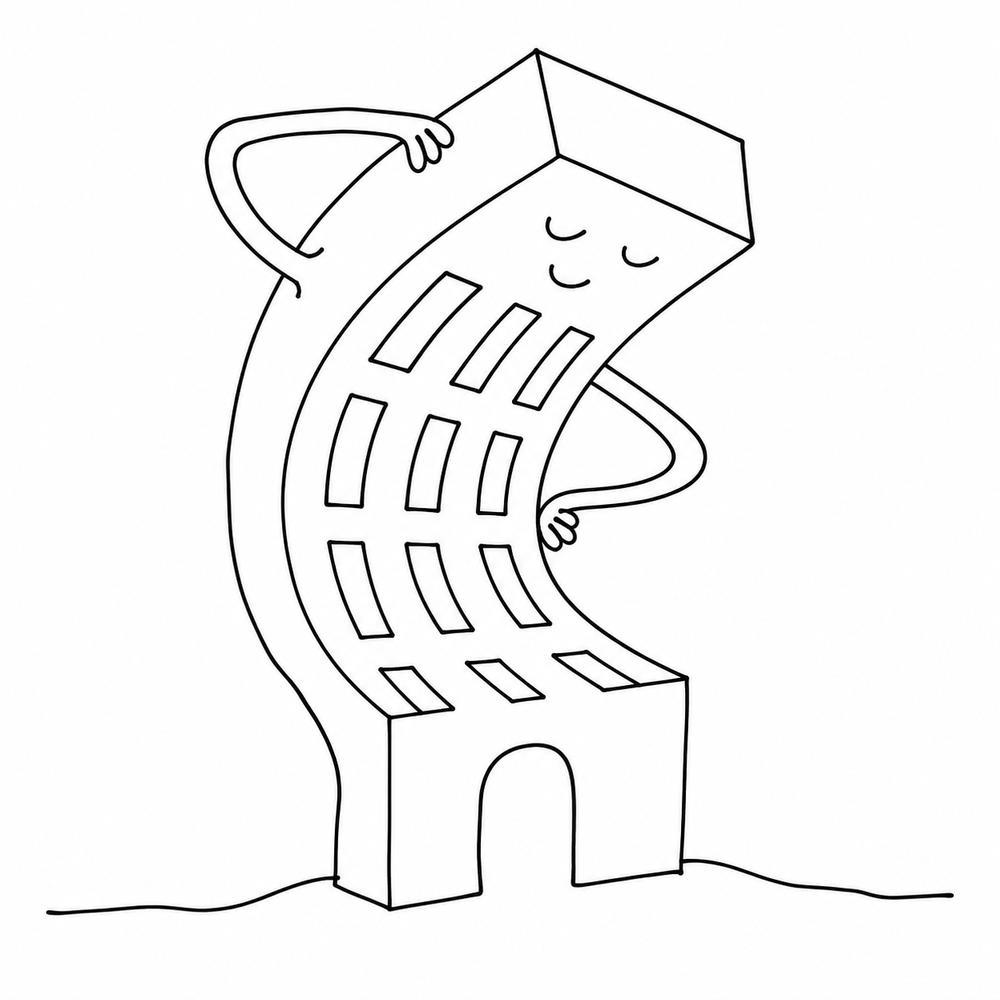

# Graduate Variable Font

College block letters that bend. Graduate is the varsity lettering stitched onto
every American campus sweatshirt — and this is the variable font that lets one
file slide from hairline to slab, condensed to expanded, without swapping styles.
Twelve axes, twenty-seven named instances, one `GRADUATE.ttf`.

The single static weight ships on [Google Fonts](https://fonts.google.com/specimen/Graduate).
This repository is the variable extension, forked from Eduardo Tunni's
[original project](https://github.com/etunni/Graduate-Variable-Font) and licensed
under the [SIL Open Font License 1.1](./OFL.txt).

Play with the axes live: **https://twardoch.github.io/Graduate-Variable-Font/**



## The font

- **File:** `fonts/variable/GRADUATE.ttf` — the built variable font
- **Version:** 3.001 · 563 glyphs · 1000 units/em
- **Source:** `sources/GRADUATE-2019.vfc` — the editable [FontLab](https://www.fontlab.com/) project
- **Specimen:** `assets/GRADUATE-VARIABLE-MAP.pdf` — the axis map poster

## Axes

Every axis below is live in the shipped font. Defaults land on the upright
`Regular`. The `min`/`max` columns are the design space you can interpolate
across in any app that speaks variable fonts.

| Tag  | Name         | Min | Default | Max | What it does |
|------|--------------|----:|--------:|----:|--------------|
| XOPQ | Weight       | 100 | 100     | 900 | Stem thickness, thin to black |
| XTRA | Width        | 100 | 400     | 800 | Counter width, condensed to expanded |
| OPSZ | Optical Size |   8 | 16      |  16 | Fine adjustments for small sizes |
| GRAD | Grade        |   0 | 0       |  20 | Weight shift without reflow |
| CNTR | Contrast     |   0 | 0       | 100 | Thick/thin stroke modulation |
| SERF | Serif        |   0 | 0       |  30 | Grows serifs onto the block forms |
| SELE | Largo Serif  | -20 | 0       |   0 | Serif length |
| YOPQ | Yopaque      | 100 | 100     | 800 | Horizontal stem thickness |
| YTRA | Ytrans       | 750 | 750     | 850 | Vertical proportions |
| YTAS | Ytas         |   0 | 0       |  50 | Ascender height |
| YTLC | Ytlc         | 650 | 650     | 750 | Lowercase (x-height) |
| YTDE | Ytde         |   0 | 0       |  50 | Descender depth |

The 27 named instances cover a weight ladder (Thin → Black) crossed with three
widths (Condensed, Regular, Expanded). Any point between them is reachable by
setting axes directly.

## Build

The font is drawn and exported from FontLab, not from a command-line pipeline.
To rebuild the binary, open `sources/GRADUATE-2019.vfc` in FontLab and export a
variable TTF over `fonts/variable/GRADUATE.ttf`.

The project **website** in `docs/` is generated from `docs-sources/` with Grunt:

```bash
npm install
npx grunt build     # compile SCSS + copy assets into docs/
npx grunt           # build, then serve at http://localhost:8081 with live reload
```

## Validate

Before shipping a new binary, check that it still parses and that all twelve axes
survived the export:

```bash
python tools/validate_font.py
```

It parses `fonts/variable/GRADUATE.ttf` and `docs/fonts/GRADUATE.ttf`, confirms
the expected axes are present, and verifies every named instance sits inside its
axis range. This same check runs in CI on every push. `fontTools` is the only
dependency; the script declares it inline, so `uv run tools/validate_font.py`
works with nothing installed.

## Contribute

Design questions, axis requests, and bug reports go to the
[issue tracker](https://github.com/twardoch/Graduate-Variable-Font/issues).
When distributing Graduate or any derivative, carry the OFL and this notice with
it.

## History

See [CHANGELOG.md](./CHANGELOG.md) for the full record, including the axis
lineage — how the design grew from 10 axes in 2018 to the current twelve.
